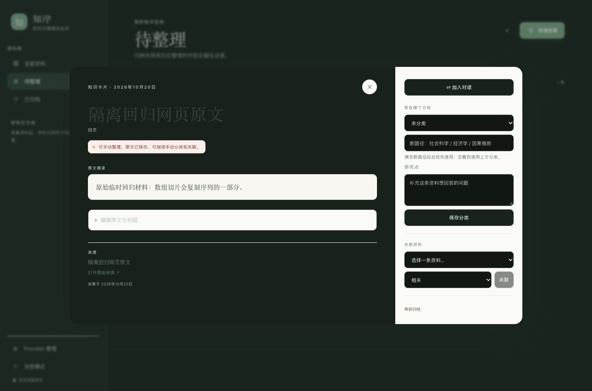
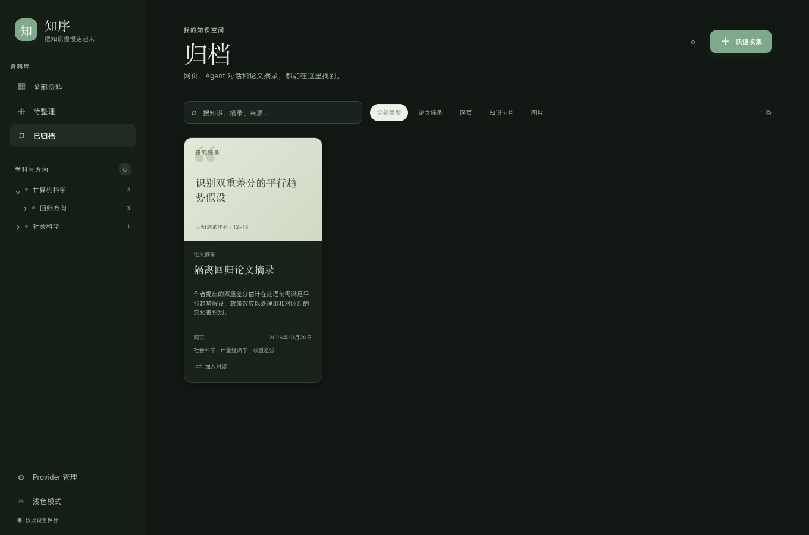
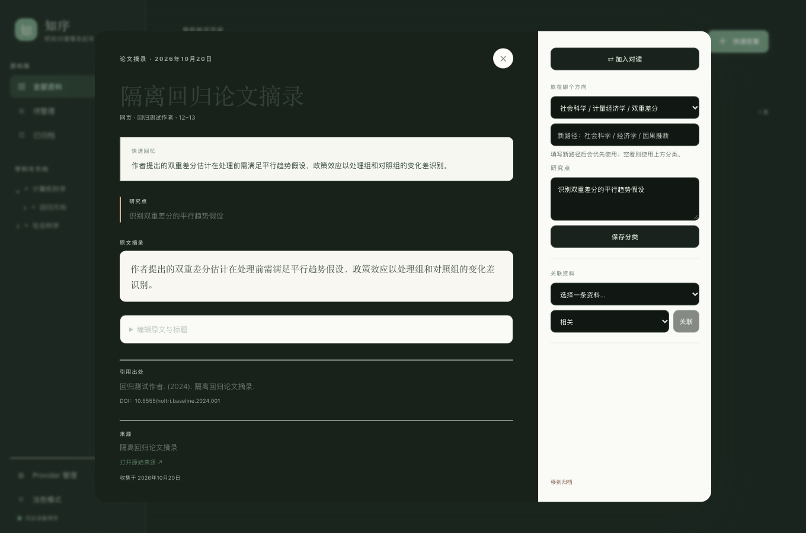

# A15–A16 原有能力回归与基线缺口

## 结论

回归基线为 `HEAD 846da32c2133c02015520335dfaff5d6dc21e904`（桌面包 `0.1.2`）。本次只验证旧收录、分类失败保留、待整理、归档恢复和论文摘录入口；没有改动产品源码。

| 验收项 | 结果 | 边界 |
| --- | --- | --- |
| A15 待整理 | **部分回归通过；整项未通过（原阶段缺口）** | 失败条目会留在待整理列表，归档列表能定位并恢复；HEAD 没有指南要求的一级→二级→三级→章节 picker、章节 hover/聚焦提示和整理完成后的结果跳转/撤销流程。 |
| A16 收录与论文 | **部分回归通过；整项未通过（原阶段缺口）** | 原文、出处、失败状态、完全重复请求和独立来源身份通过真实服务回归；同论文不同摘录没有共享来源实体，HEAD 也没有独立论文研究页或显式幂等转入。 |
| F05 无目标覆盖诊断 | **原阶段未实现；未作行为通过判定** | HEAD 有 `masteryLevel` 数据字段，但没有选定目标后的覆盖/薄弱点功能界面或服务。不能把“无诊断 UI”记成 A16 通过。 |
| F06 范围内对话 | **服务 API 已有；桌面入口未见；本次未测** | HEAD 有 `/api/node-context`、`/api/chat`、conversation API；桌面 Workbench 没有对话入口。 |
| 修改历史 | **原阶段不完整** | SQLite 有 `version_records` 表；HEAD 的 HTTP 路由没有版本查询接口，Node Engine 注释也将 history 留到 V2。 |

上表将原阶段缺项与本轮回归分开：A15/A16 整项不能标 `passed`，但已实现子路径的实际回归结果保留为通过；未实现能力没有通过模拟 UI 或扩大本轮开发来补齐。

## 隔离环境与执行边界

- HEAD：`846da32c2133c02015520335dfaff5d6dc21e904`，桌面包 `0.1.2`。静态边界以该 HEAD 文件为准。
- 浏览器：`http://127.0.0.1:1437/main.html`，由现有 `apps/desktop/dist` 通过 Vite production preview 提供；没有重新构建。
- API：`http://127.0.0.1:1436`，本轮隔离启动的 Knowledge Core HTTP 服务。SQLite 文件 `/private/tmp/noltri-graph-v31-baseline-regression/regression.sqlite`，测试用户 `graph-v31-baseline-regression-user`；启动时数据库为空。
- WebView 仅注入 `get_settings` Tauri bridge，使前端连到隔离 API 1436；其余 API 请求均由浏览器真实发送到本地服务。AI provider 是 loopback 假服务 `127.0.0.1:1438`，只用于确定性地让第一次分类响应失败、之后重试成功；没有调用外部模型、用户密钥或用户库。
- 使用独立 Chrome target/context；没有触碰 1431/1433、A12/CS/Python/C++ fixture 或其 SQLite。测试数据仅为临时虚构文本和 `example.org` URL。

源码归属核对：`git diff --exit-code HEAD -- services/knowledge-core/src/pipeline/capture.ts services/knowledge-core/src/services/library.ts` 无差异；本轮 router diff 只增加 Graph/notes 路由，既有 items/capture/inbox 路由保持原样。`WorkbenchApp.tsx` 有本轮 Graph 集成改动，但当前 `CaptureDialog`、`ItemDetailDialog`、`CompareDialog` 函数块与 HEAD 字节一致。以下列出的 A15/A16 缺口都可在 HEAD `0.1.2` 中确认；没有把它们归因成本轮改动。

精确复核命令：

```sh
git diff --exit-code HEAD -- services/knowledge-core/src/pipeline/capture.ts services/knowledge-core/src/services/library.ts
node /private/tmp/noltri-graph-v31-baseline-regression/compare-baseline-components.mjs
```

启动命令（均指向临时验收配置）：

```sh
pnpm --filter @noltri/knowledge-core exec tsx /private/tmp/noltri-graph-v31-baseline-regression/server.mts
pnpm --filter @noltri/desktop exec vite preview --host 127.0.0.1 --port 1437 --strictPort
node /private/tmp/noltri-graph-v31-baseline-regression/ai-stub.mjs
node /private/tmp/noltri-graph-v31-baseline-regression/cdp-runner.mjs
node /private/tmp/noltri-graph-v31-baseline-regression/baseline-api-check.mjs
```

## 已实现路径的真实回归

### 收录、失败保留、重放与来源身份

在生产预览中使用“快速收集”，提交虚构网页标题 `隔离回归网页原文`、原文 `原始临时回归材料：数组切片会复制序列的一部分。` 和来源 URL `https://example.org/noltri-baseline-regression/article-a`。本地 provider 的提取成功、分类失败。详情显示“原文已保存，可继续手动分类和关联”；原文和来源链接仍可见，列表进入“待整理”。

实际 HTTP/SQLite 结果：

- RawSource/item ID：`ccb1883d-2f45-4873-a0a9-494af07cb0f9`；`GET /api/items/:id` 的原文、标题和 URL 与输入完全相同，`aiStatus=failed`。
- `GET /api/items?state=organize&query=隔离回归网页原文&limit=10` 与 `GET /api/inbox?status=failed&limit=10` 均包含该 ID；`GET /api/inbox/:id` 返回同一原文和来源 URL。
- 对同一 `POST /api/items` 输入重放两次后，均返回同一 ID；第一次重放重新处理原失败行并变成 `ready`，`rawSources` 数仍为 1。没有因重试再存一份原文。
- 相同原文改成独立 URL `article-b` 后生成新 ID `7a3cd24a-6360-4ba9-a275-38b386c7101a`；因此不同来源不会仅因正文相同而合并。
- 对同一个 `article-a` 提交另一段不同原文，会生成独立记录 `6070f1c5-2db2-475f-af55-d0eb3fcc858a`。这验证了记录级重复处理，但不能证明“多选段共享一个来源实体”；见 A16 基线缺口。

核心命令：`node /private/tmp/noltri-graph-v31-baseline-regression/baseline-api-check.mjs`。脚本断言隔离库名、原文与来源、失败 inbox、organize 列表、重复重放 ID/状态和来源计数。数据库由 `node:sqlite` 只读检查；该命令输出 3 个 RawSource（论文 UI 收录之前），项目服务启动时 health 返回空库，`sqlite` 文件名为 `regression.sqlite`。

基线实现位置：`services/knowledge-core/src/pipeline/capture.ts:112-150` 先落 RawSource 再处理；`:153-160` 重试原行；`:168-186` 处理幂等重放；`:201-217` 将 provider 失败标记并保留 RawSource。原单测 `services/knowledge-core/test/capture-pipeline.test.ts:57-74` 也覆盖同一 RawSource retry，但本报告的通过结论以上述真实 HTTP/SQLite 结果为准。



### 待整理列表及归档恢复

失败记录在生产预览“待整理”列表中出现。随后将论文摘录从详情“移到归档”，切换“已归档”列表仍能看到同一张卡片；打开卡片并点“恢复到资料库”后，归档列表显示空态。恢复后 `GET /api/items?state=archive&limit=20` 返回空列表。这验证的是现有“归档 → 已归档 → 恢复到资料库”路径；没有把它描述为指南要求的四级分类完成后结果跳转或一次性撤销。



基线实现位置：`apps/desktop/src/workbench/WorkbenchApp.tsx:275-291` 的归档/恢复动作，`:909` 的详情操作；`services/knowledge-core/src/services/library.ts:363-409` 保存归档链接并在恢复时重建；`services/knowledge-core/src/http/router.ts:77-80` 暴露条目归档和恢复路由。归档恢复结果由上述真实 UI 与隔离 API 观察。

### 论文摘录原入口

在生产预览的“快速收集”将类型选为“论文摘录”，填写虚构标题、研究点、原文、作者、页码、DOI、引用、标签、URL 和三段 subject path。保存后“论文摘录”过滤器显示条目，详情显示研究点、引用/DOI、原文、作者页码及“打开原始来源”。`GET /api/items?state=all&query=隔离回归论文摘录&limit=10` 返回 kind=`paper_excerpt`，ID `ed7654b4-71fc-4083-a5b1-7d4f0f50fcc6`，上述元数据及原文与输入一致。详情页随后通过真实 UI 归档、恢复。



对应 HEAD：`apps/desktop/src/workbench/WorkbenchApp.tsx:645-757` 构造 `paper_excerpt` 收录输入；`:604-610` 显示摘录卡片；`:865-881` 显示详情与来源；`:915-938` 提供对读；`services/knowledge-core/src/services/library.ts:195-236` 走既有 capture pipeline 并保存研究/引用元数据。真实 API 仍经通用 `POST /api/items`，没有单独的论文转入接口。

## A15/A16 的原阶段缺口

| 指南要求 | HEAD `0.1.2` 观察 | 本轮分类 |
| --- | --- | --- |
| A15 一级→二级→三级→章节 picker；尾部仅显示三级、hover/聚焦可见章节；上级变更清理下级 | 收集和详情只有一个路径下拉框及 `/` 分隔自由文本输入（WorkbenchApp.tsx:681-699、:733-739、:886-894）。没有分级选择状态或章节 hover 提示。 | **原阶段未实现；不属于本轮回归失败。** |
| A15 AI 不覆盖人工目标 | 论文摘录 UI 明确提交 `社会科学 / 计量经济学 / 双重差分`；隔离 provider 在其它分类请求中会给出 `计算机科学 / 回归方向 / 回归主题`，实际论文 item 仍保存为人工 subjectPath。服务 `placeInManualPath` 会先检查该路径再调用分类器（capture.ts:390-411）。 | **路径优先级回归通过；picker 仍缺。** |
| A15 未完成项保留草稿、完成后定位结果并撤销 | 失败项保留在待整理列表已测；详情可保存分类、归档页可恢复。未发现四级整理后的结果跳转和就地撤销行为。 | **部分既有能力通过，指南完整流程仍缺项。** |
| A16 同论文多个选段共享原始来源 | 同一个论文 URL/标题但不同摘录内容通过两次 HTTP `POST /api/items` 后 ID 不同：`ed7654b4-71fc-4083-a5b1-7d4f0f50fcc6` 和 `2c0789ca-48ae-4005-a484-29e428b988c7`；最后 SQLite `raw_sources` 为 5 行。来源元数据相同，但没有共享来源 ID。 | **原阶段缺口；A16 不可整体通过。** |
| A16 独立论文研究页与显式“整理为学科知识”、重复转入幂等且保留论文记录 | HEAD 桌面源文件只有 `WorkbenchApp.tsx`、`api.ts` 等 Workbench/设置文件；其中只呈现摘录、详情、对读。HEAD 路由表没有研究页/论文转入路由，仅通用 items/capture/inbox 路由。 | **原阶段未实现；未造假 UI，也未作幂等转入通过判定。** |
| A16 无选定目标不生成掌握诊断 | HEAD 仅有知识节点 `masteryLevel` 枚举与默认值 `collected`（`packages/schema/src/knowledge.ts:54-68`、`packages/schema/src/enums.ts:80-92`）；无目标框架覆盖或薄弱点诊断服务/UI。 | **原阶段功能缺口；未将无功能误记通过。** |

论文多选段复核命令为隔离服务上的 `POST http://127.0.0.1:1436/api/items`（同 `paper-a` URL/DOI、`kind=paper_excerpt`、不同正文与页码 `14`），随后 `GET /api/health` 和只读 SQLite `raw_sources` 计数；API 返回新 ID `2c0789ca-48ae-4005-a484-29e428b988c7`，计数增至 5。测试前已有四行：网页失败收录、同论文的另一段知识条目、独立来源同文、论文 UI 首摘录；因此第五行是本次第二个论文摘录，不是用户数据。

指南第 6 节其它相关边界：HEAD 的服务端有 `/api/node-context`、`/api/chat` 与 conversation/message 路由（`services/knowledge-core/src/http/router.ts:92-95,352-372`）及 `services/knowledge-core/src/services/conversation.ts`，但 `apps/desktop/src` 中没有对话页面；`version_records` 存储表本身不等于可查阅修改历史，Node Engine 注释明确把 history 留在 V2（`services/knowledge-core/src/services/node.ts:1-5`）。本次未运行 F06 对话或历史用例，以上只作为 HEAD 能力盘点，不列为通过。

## 证据文件与复核

- [分类失败保留原文截图](baseline-failed-capture-detail.png)
- [论文摘录详情截图](baseline-paper-excerpt-detail.png)
- [归档列表截图](baseline-paper-archive-card.png)
- 隔离 API 与 UI 操作脚本位于 `/private/tmp/noltri-graph-v31-baseline-regression/`；其中 `baseline-api-check.mjs` 可按上文命令重放原文/失败/重复请求断言，`cdp-runner.mjs` 为单独 Chrome browser context，并通过 CDP 截图。脚本、数据库、provider stub 均为临时验收材料，不作为产品文件提交。
- 本次没有重建、没有运行全仓测试，也没有对未实现的 A15/A16 能力搭模拟界面。
