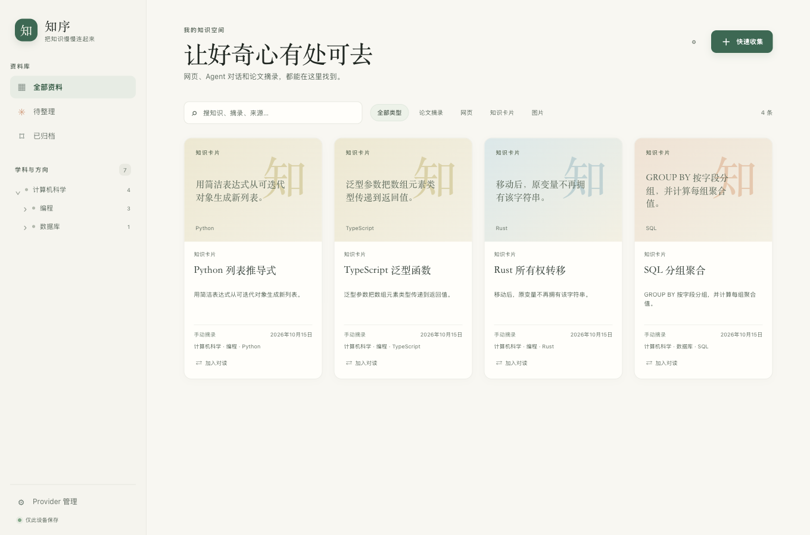

# Graph v3.1 P0 visual baseline

Captured 2026-10-20 (Asia/Shanghai) from the HEAD snapshot at commit `846da32c2133c02015520335dfaff5d6dc21e904`, served from `/private/tmp/noltri-graph-v31-baseline/apps/desktop` with:

```sh
./node_modules/.bin/vite --host 127.0.0.1 --port 1421 --strictPort
```

Vite was process `69463`, exec session `10268`; the page was `http://127.0.0.1:1421/main.html` (the application entry is `main.html`, so `/` returns 404). The browser viewport was 1360 × 900 CSS pixels at DPR 1, with the light color scheme.

The interaction path was `main.html` → first-run model setup → **进入知识库** → **我的知识空间** → **全部类型**. The baseline shows the original four `MemoryCard` examples: Python 列表推导式, TypeScript 泛型函数, Rust 所有权转移, and SQL 分组聚合. To keep this independent of a production database, the browser intercepted API fetches and returned the existing classification fixture-shaped responses in memory. It did not write user data or add fixture data to product code. These four cards are therefore UI fixture examples, not a claim about the user's installed database.



The HEAD UI had no theme control or dark-theme styles, so there is no genuine pre-change dark screenshot. The initial untracked `lighthouse-developers-chrome.report.html` and `.json` files were left untouched.
